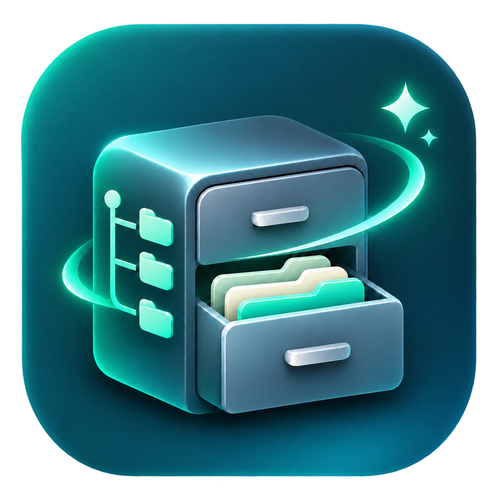

# 磁盘清理助手



一个面向 Windows 的本地磁盘空间分析与大文件清理工具。第一版聚焦三个动作：看清空间占用、筛选大文件、确认后移入回收站。

## 已实现

- 展示本机固定磁盘的容量、已用空间和可用空间。
- 扫描整块磁盘或指定文件夹，统计一级目录占用。
- 按 100 MB、500 MB、1 GB、2 GB、5 GB 阈值查找大文件。
- 按视频、压缩包、安装包、图片、文档等类型筛选，并支持名称/路径搜索。
- 扫描可随时取消；无权限目录会跳过并计数；重解析点会跳过以避免目录循环。
- 手动勾选候选文件，清理前二次确认，文件默认移入 Windows 回收站。
- 清理后立即更新候选列表、目录统计和磁盘容量。

## 直接使用便携版

从 GitHub Releases 下载 `DiskLens-win-x64.zip`，解压后双击 `DiskLens.exe`。精简包只有程序和使用说明两个文件，程序已经包含 .NET 运行环境，不需要安装 Visual Studio 或 .NET。

`DiskLens.exe` 可以单独复制和运行。如果程序报告运行错误，诊断日志位于 `%LOCALAPPDATA%\DiskLens\logs`。

## 开发环境

- Windows 10 1809 或更高版本，推荐 Windows 11。
- [.NET 8 SDK](https://dotnet.microsoft.com/download/dotnet/8.0)。
- Visual Studio 2022 可选；如使用 Visual Studio，请安装“.NET 桌面开发”工作负载。

## 启动

在项目根目录执行：

```powershell
dotnet restore
dotnet run --project .\src\DiskCleanerAssistant\DiskCleanerAssistant.csproj
```

也可以用 Visual Studio 打开 `DiskCleanerAssistant.sln`，将 `DiskCleanerAssistant` 设为启动项目后运行。

## 发布精简单文件程序

```powershell
dotnet publish .\src\DiskCleanerAssistant\DiskCleanerAssistant.csproj `
  -c Release `
  -r win-x64 `
  --self-contained true `
  -p:PublishSingleFile=true `
  -p:IncludeNativeLibrariesForSelfExtract=true `
  -p:EnableCompressionInSingleFile=true
```

发布结果位于 `src\DiskCleanerAssistant\bin\Release\net8.0-windows\win-x64\publish`。

## 使用说明

1. 在顶部选择磁盘卡片，或通过“选择文件夹”指定扫描范围。
2. 选择大文件阈值并开始扫描。
3. 在左侧查看一级目录占用，在右侧筛选和勾选大文件。
4. 点击“移入回收站”，核对文件数量及预计释放空间后确认。

建议先用普通用户权限运行。Windows、Program Files 等受保护目录无法读取时会自动跳过；无需为了完整扫描而使用管理员权限。

## 代码结构

```text
src/DiskCleanerAssistant/
├── Commands/       ICommand 实现
├── Models/         磁盘、目录、文件和扫描结果模型
├── Services/       磁盘枚举、目录扫描、回收站和系统对话框
├── Utilities/      文件大小格式化
├── ViewModels/     主界面状态与操作流程
├── App.xaml        全局主题和控件样式
├── app.manifest    Windows 兼容性与普通用户权限清单
└── MainWindow.xaml 主界面
```
